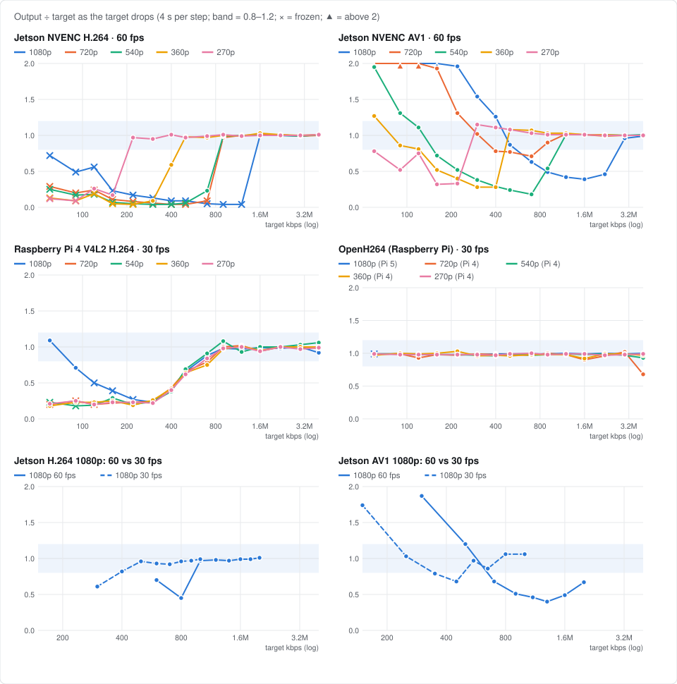
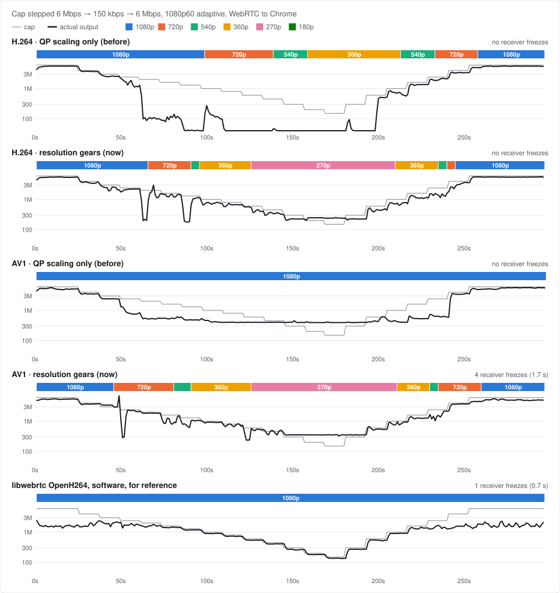
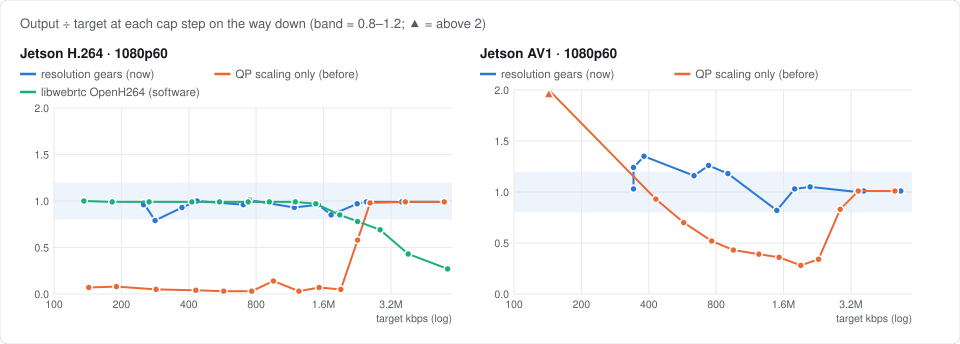

# Low Bitrate

When the network slows down, WebRTC lowers the video bitrate. In adaptive mode (the default) it also lowers the resolution, one step at a time and at the same frame rate:

1920×1080 → 1280×720 → 960×540 → 640×360 → 480×270

How well this works depends on how closely the encoder follows the bitrate WebRTC asks for. This page shows measured curves for each encoder and what pi-webrtc does about them on the Jetson.

- [How encoders follow the target](#how-encoders-follow-the-target)
- [Resolution steps on the Jetson](#resolution-steps-on-the-jetson)
- [Fixed resolution](#fixed-resolution)
- [Raspberry Pi](#raspberry-pi)

## How encoders follow the target

Each line is one resolution. The target starts at 4 Mbps and drops one step every 4 seconds. A value near 1.0 (the shaded band) means the encoder sent what WebRTC asked for.

- **Jetson NVENC (H.264 and AV1)** follows the target down to a point that depends on the resolution, then falls off a cliff. H.264 sends almost nothing (skip frames, so the picture stops moving). AV1 sends too little, and at the bottom too much. The smaller the resolution, the lower the cliff.
- **Raspberry Pi 4 V4L2** follows the target down to about 0.7 Mbps, then sends 20–60% of it at every resolution. A lower resolution doesn't help it.
- **OpenH264** follows the target at every resolution. Only the picture quality drops.
- **Frame rate**: the cliff depends on the bits per frame, so at 30 fps it sits at about half the 60 fps bitrate (bottom row).

The cliffs also move with the scene. The Jetson curves above were measured on a bright, plain wall, where the cliffs were the highest we saw. A darker or busier scene holds a lower bitrate.

## Resolution steps on the Jetson

WebRTC normally lowers the resolution when the encoder's QP gets high. NVENC keeps its QP almost flat while it starves, so WebRTC doesn't notice and stays at a resolution the encoder can't sustain. For H.264, WebRTC also replaces the QP thresholds an encoder reports with its own (24 and 37).

In adaptive mode, pi-webrtc's Jetson encoder therefore tells WebRTC the bitrate range of each resolution (`resolution_bitrate_limits`). WebRTC then switches resolution by the bitrate the encoder actually produces, before the encoder reaches its cliff:

| Resolution | H.264 steps down below | H.264 steps up at | AV1 steps down below | AV1 steps up at |
|---|---|---|---|---|
| 1920×1080 | 1.92 Mbps | — | 3.6 Mbps | — |
| 1280×720 | 1.08 Mbps | 2.4 Mbps | 1.08 Mbps | 4.5 Mbps |
| 960×540 | 1.08 Mbps | 1.35 Mbps | 1.08 Mbps | 1.35 Mbps |
| 640×360 | 600 kbps | 1.35 Mbps | 600 kbps | 1.35 Mbps |
| 480×270 | lowest step | 750 kbps | lowest step | 750 kbps |

"Steps down below" is the encoded bitrate. "Steps up at" is the bitrate WebRTC must have for the next larger resolution. The values are for 60 fps and scale with `--fps`. The lowest step is 480×270, which keeps at least 251 kbps (H.264) or 342 kbps (AV1) at 60 fps.

- **QP scaling only (before)**: from 2 Mbps down, H.264 sends 3–14% of the target, and it only gets back to 1080p at 6 Mbps. AV1 never leaves 1080p. It sends 28–52% of the target in the middle and up to 5.5 times at the bottom.
- **Resolution steps (now)**: both codecs stay close to the target, step down to 480×270 and climb back to 1080p. WebRTC checks every 5 seconds, so if a scene pushes a cliff above its step, the output can dip for a few seconds before the switch. A switch can also stall the picture briefly (AV1 here: 1.7 s when going from 1080p to 720p).
- **libwebrtc's OpenH264** (software, on the Jetson's CPU, for reference) stays at 1080p the whole way. On this scene its QP stays below 31 even at 150 kbps, so QP scaling has no reason to switch. Above 2 Mbps it sends less than the target because the still picture needs no more. The hardware encoder falls off a cliff where the software one doesn't.

You can also keep NVENC above its cliff by setting `--min-bitrate` high enough for your resolution and frame rate, for example the values in [Fixed resolution](#fixed-resolution). The stream then never goes below that bitrate. On a link slower than the floor the video lags or breaks up, instead of adapting.

## Fixed resolution

With `--no-adaptive`, the resolution never changes. On the Jetson with `--hw-accel`, pi-webrtc then keeps the bitrate above the point where NVENC freezes, unless you set `--min-bitrate`. The floor is `fps × max(0.013 × width × height, 20 kbit)` per second:

| Video | Floor |
|---|---|
| 1920×1080, 60 fps | 1.6 Mbps |
| 1920×1080, 30 fps | 0.8 Mbps |
| 1280×720, 60 fps | 1.2 Mbps |
| 1280×720, 30 fps | 0.6 Mbps |

## Raspberry Pi

The Raspberry Pi encoders use WebRTC's QP-based scaling:

- OpenH264 follows the target, so its QP tracks the picture quality and the resolution changes where it should.
- The V4L2 encoder sends too little at every resolution below about 0.7 Mbps, so switching by bitrate would not help it.
